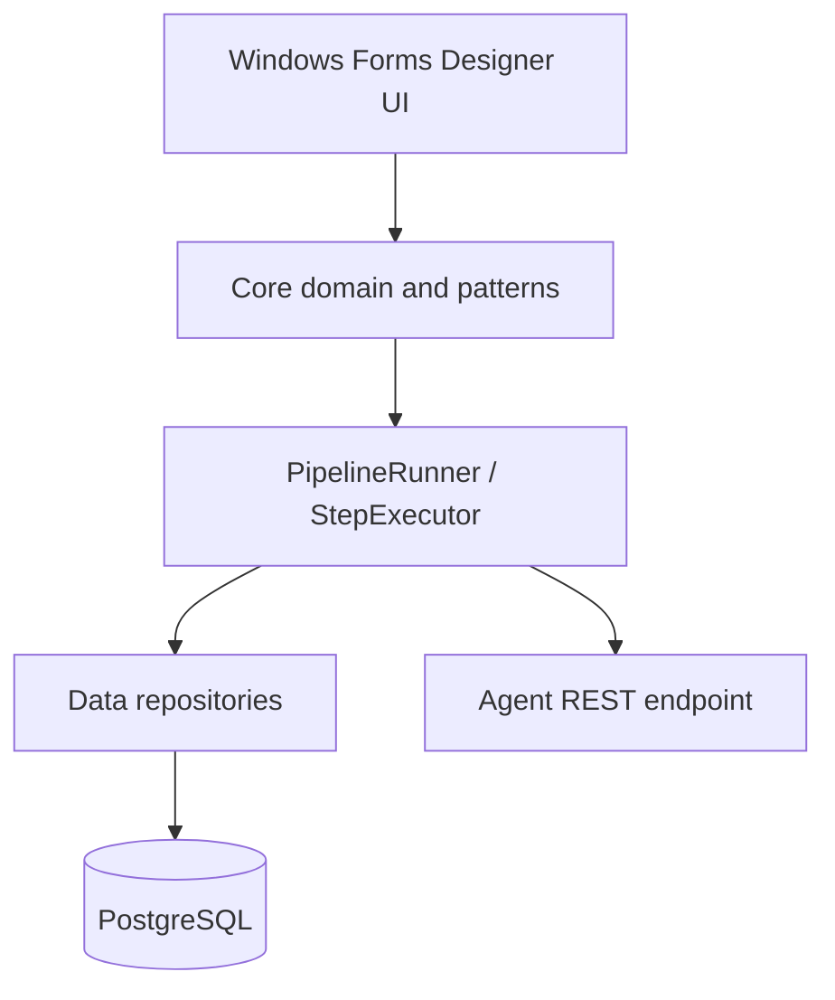

# Weaverxyz

Desktop Data Pipeline Orchestrator built from scratch in C#/.NET 8. Weaverxyz has two equal objectives: demonstrate Software Engineering principles academically and provide a functional local orchestrator.

## System

A pipeline is an ordered sequence of `Step` objects that reads from a `DataSource`, transforms data, optionally calls an AI Agent, and writes to a `Sink`. `PipelineRunner` coordinates execution; it does not own the UI or SQL implementation.



## Technology stack

| Component | Decision |
|---|---|
| Language | C# 12 |
| Runtime | .NET 8 |
| IDE/UI | Visual Studio 2022 Community + Windows Forms Designer |
| Database | PostgreSQL |
| Driver | Npgsql |
| Configuration | Versioned schemas and environment overlays; secrets via `.env` or secret store |

## Solution structure

```text
PipelineOrchestrator.sln
├── PipelineOrchestrator.UI      — Windows Forms views/events, editable in VS Designer
├── PipelineOrchestrator.Core    — domain, orchestration contracts, design patterns
└── PipelineOrchestrator.Data    — repository implementations, Npgsql, SQL/migrations
```

Dependency direction: `UI → Core`; `Data → Core`. `Core` defines abstractions, `Data` implements them, and `UI` composes the application at runtime.

## Design decisions

- Every `StepCommand` implements `Execute()` and `Rollback()`.
- Failed execution rolls back completed commands in reverse order, then stops and logs.
- Step types are an open set registered without changing the database schema.
- UI updates are hybrid: `ProgressReporter` pushes step events; a 500 ms Timer refreshes aggregate state.
- Common persistence fields are typed; step-specific configuration and snapshots use JSONB.
- AI credentials never enter code, Git, or PostgreSQL.

See `docs/adr/` for accepted decisions.

## GitHub Project governance

Weaverxyz uses one repository-level GitHub Project V2. Its declarative manifest is `.github/project/project-manifest.yml`; authority rules are in `.github/project/authority-matrix.yml`.

- Project V2 is authoritative for planning fields.
- Issues and PRs are authoritative for requirements, evidence, and relationships.
- Labels are routing compatibility, not a second planning database.
- Routine synchronization may run automatically; configuration mutations require dry-run and human approval.
- Conflicts fail closed and require explicit resolution.

Issue Forms, workflows, documentation governance, and rollback procedures are documented under `.github/`, `docs/reference/agents/`, and `docs/runbooks/`.

## Documentation map

- `CONTEXT.md` — stable domain vocabulary and boundaries.
- `docs/adr/` — architecture decisions.
- `docs/architecture/` — diagram-as-code sources.
- `docs/theory/` — Software Engineering theory and quality model.
- `docs/reference/agents/documentation-index.md` — governed documentation index.
- `docs/reference/agents/github-project.md` — Project V2 governance.
- `docs/runbooks/` — operational recovery procedures.

## Validation

```bash
node .agents/skills/platform/check-all.mjs
```

Expected: `status: "pass"`, `failed: 0`, `totalWarnings: 0`, `totalErrors: 0`.

## Functional scope

The primary user journey is: design → validate → version → execute → monitor → inspect → compare → improve. The canonical model is a DAG; the first execution strategy is sequential topological traversal, with future parallelism constrained by dependencies, resources, idempotency, and security.

The capability catalog includes `FileSource`, `PostgresSource`, `HttpSource`, transformations, validators, `AgentCall`, `FileSink`, `PostgresSink`, `ReportSink`, and `SubPipeline`. Every Step uses versioned input/output contracts and transports a classified `DataPacket`.

Every execution is versioned, hashed, incrementally persisted, observable, recoverable, and linked to redacted evidence. See `docs/reference/functional-specification.md` and `docs/reference/objectives-and-success.md`.

## Scope boundaries

Initial phases do not include multi-user collaboration, distributed execution, high availability, external scheduling, queues/event buses, cloud deployment, or native cross-platform UI. New capabilities require an explicit scope decision, ADR, risk analysis, Project metadata, and updated success criteria.

## Work item hierarchy

Planning follows a native GitHub hierarchy:

```text
Milestone
└── Parent Spec (Issue)
    └── Sub-Spec (Sub-issue)
        └── Ticket (Sub-issue)
```

There is one root Parent Spec per Milestone by default. Parent Specs are created and refined first; Sub-Specs and Tickets are generated only after their ancestor contracts pass Definition of Ready. All comments are English engineering records with operation IDs, evidence, decisions, risks, quality gates, and next steps.

See `docs/reference/work-items/` for governance and templates.
