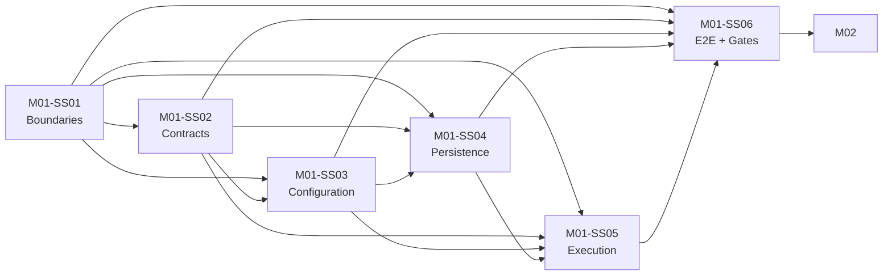

# M01 Dependency Graph

## Claimable waves

1. **Wave 1:** M01-SS01.
2. **Wave 2:** M01-SS02.
3. **Wave 3:** M01-SS03.
4. **Wave 4:** M01-SS04.
5. **Wave 5:** M01-SS05.
6. **Wave 6:** M01-SS06.

The strict sequence is intentional: each Sub-Spec establishes contracts consumed by the next. Parallel Tickets may be introduced inside a Sub-Spec only when their local dependencies permit it.

## Invariants

- No cycle exists.
- No Sub-Spec is claimable before its dependencies satisfy DoD.
- SS06 cannot start integration until SS01–SS05 provide accepted contracts.
- M02 cannot start from M01 until SS06 release evidence is accepted.
