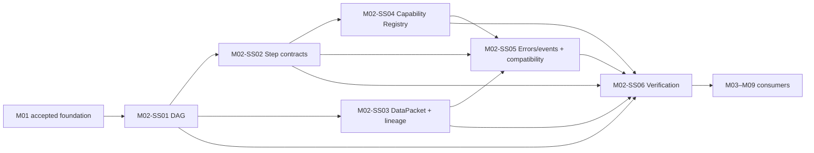

# M02 Dependency Graph

## Claimable waves

1. Wave 1: M02-SS01.
2. Wave 2: M02-SS02 and M02-SS03, after SS01 contracts are accepted.
3. Wave 3: M02-SS04, after SS02 is accepted.
4. Wave 4: M02-SS05, after SS02–SS04 are accepted.
5. Wave 5: M02-SS06, after SS01–SS05 are accepted.

## Invariants

- No dependency cycle exists.
- No Sub-Spec is claimable before its dependencies satisfy DoD.
- M02 does not alter M01 boundaries without an approved ADR.
- M03 consumes M02 contracts and does not redefine them.
- Tickets remain deferred until the corresponding Sub-Spec is accepted.
