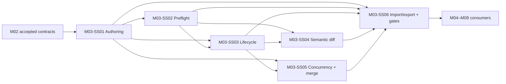

# M03 Dependency Graph

## Claimable waves

1. Wave 1: M03-SS01.
2. Wave 2: M03-SS02.
3. Wave 3: M03-SS03 and M03-SS04.
4. Wave 4: M03-SS05.
5. Wave 5: M03-SS06.

## Invariants

- No dependency cycle exists.
- M03 cannot redefine accepted M02 domain contracts.
- Publication remains blocked until preflight and lifecycle evidence pass.
- Tickets remain deferred until the corresponding Sub-Spec is accepted.
