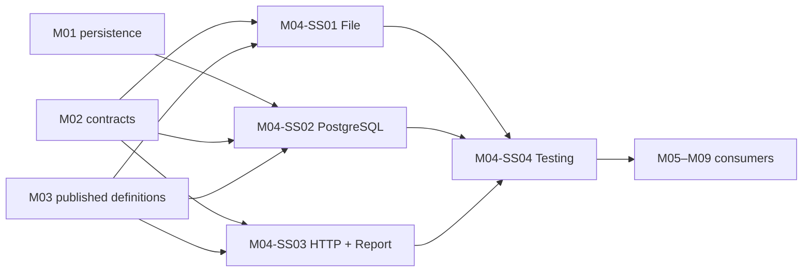

# M04 Dependency Graph

## Claimable waves

1. Wave 1: M04-SS01, M04-SS02, and M04-SS03 may proceed in parallel after their declared dependencies are accepted.
2. Wave 2: M04-SS04 after SS01–SS03 provide stable contracts.

## Invariants

- No connector bypasses the M02 Capability Registry or common contract.
- No connector persists or logs secret values.
- External destinations are allowlisted and validated before side effects.
- SS04 cannot pass while any connector security or recovery gate is failing.
- Tickets remain deferred until the corresponding Sub-Spec is accepted.
