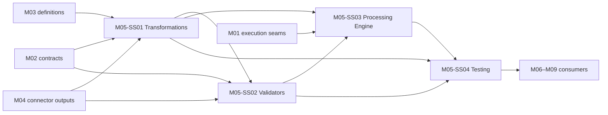

# M05 Dependency Graph

## Claimable waves

1. Wave 1: M05-SS01.
2. Wave 2: M05-SS02.
3. Wave 3: M05-SS03.
4. Wave 4: M05-SS04.

## Invariants

- Transformations and validators use accepted M02 contracts and do not bypass the registry.
- Critical quality/security failures cannot be hidden by collect-all or quarantine policy.
- Processing budgets fail closed.
- M06 owns orchestration-level retry/rollback/recovery, while M05 owns processing outcomes.
- Tickets remain deferred until Sub-Spec acceptance.
