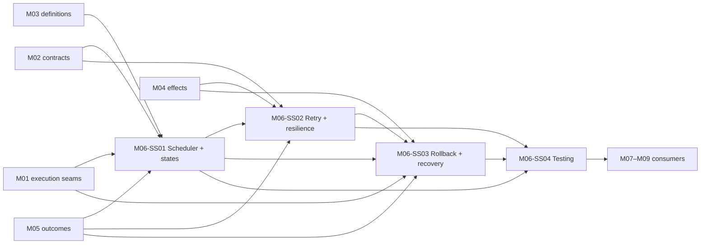

# M06 Dependency Graph

## Claimable waves

1. Wave 1: M06-SS01.
2. Wave 2: M06-SS02.
3. Wave 3: M06-SS03.
4. Wave 4: M06-SS04.

## Invariants

- Runtime retry and recovery cannot bypass M02 idempotency/compensation contracts.
- Compensation failures preserve original failure context and residual risk.
- Recovery never restarts uncertain effects blindly.
- M07 consumes runtime state/events and does not redefine them.
- Tickets remain deferred until Sub-Spec acceptance.
