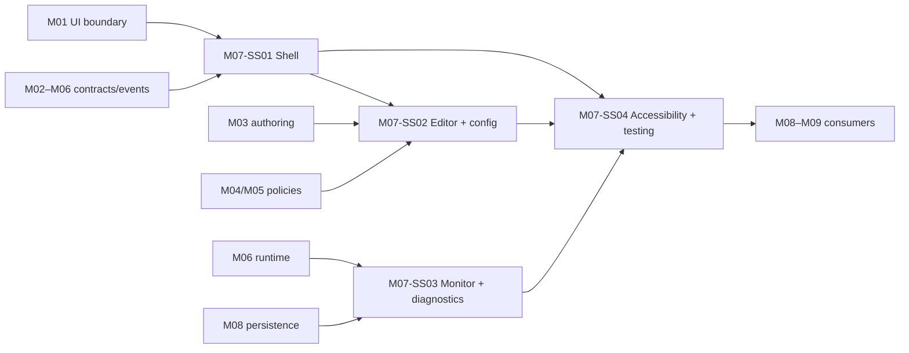

# M07 Dependency Graph

## Claimable waves

1. Wave 1: M07-SS01.
2. Wave 2: M07-SS02 and M07-SS03 after their declared contracts are available.
3. Wave 3: M07-SS04.

## Invariants

- UI never bypasses Core or accesses SQL/Npgsql directly.
- Designer-generated code remains isolated.
- Runtime events and states are displayed, not redefined, by UI.
- Accessibility gates block completion when critical barriers remain.
- Tickets remain deferred until Sub-Spec acceptance.
