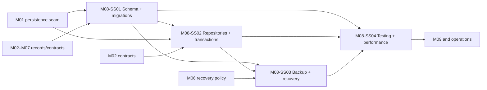

# M08 Dependency Graph

## Claimable waves

1. Wave 1: M08-SS01.
2. Wave 2: M08-SS02.
3. Wave 3: M08-SS03.
4. Wave 4: M08-SS04.

## Invariants

- No repository bypasses Core contracts or leaks SQL/Npgsql outside Data.
- No migration proceeds with checksum drift or unapproved destructive change.
- Restore must validate integrity and pending migrations before acceptance.
- Retention cannot delete records required for audit/recovery without policy evidence.
- Tickets remain deferred until Sub-Spec acceptance.
