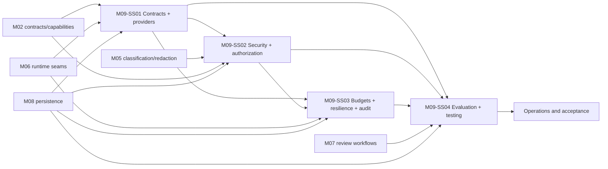

# M09 Dependency Graph

## Claimable waves

1. Wave 1: M09-SS01.
2. Wave 2: M09-SS02.
3. Wave 3: M09-SS03.
4. Wave 4: M09-SS04.

## Invariants

- Unregistered providers/models and absent authorization fail closed.
- Secrets and unsafe sensitive payloads never cross the provider boundary.
- Invalid responses are quarantined rather than treated as successful.
- Retries and fallbacks cannot duplicate external effects or bypass budgets.
- Audit evidence is redacted, correlated, retained, and reconciled.
- High-impact effects require configured human review.
- Tickets remain deferred until Sub-Spec acceptance.
