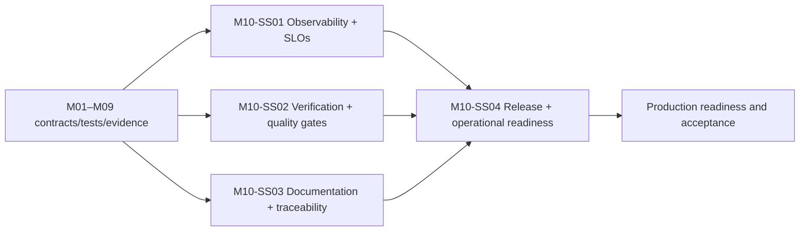

# M10 Dependency Graph

## Claimable waves

1. Wave 1: M10-SS01, M10-SS02, and M10-SS03 can progress in parallel where inputs are available.
2. Wave 2: M10-SS04 consumes the three preceding quality seams.

## Invariants

- Critical quality, security, privacy, performance, resilience, accessibility, and documentation failures block release.
- Telemetry is correlated, redacted, access-controlled, and retention-governed.
- Release artifacts have reproducible provenance and tested rollback.
- Breaking changes and deprecations have migration, communication, ownership, and retirement evidence.
- Incidents produce actionable learning into requirements and architecture.
- Tickets remain deferred until Sub-Spec acceptance.
