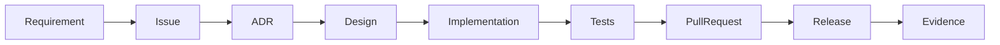

# Software Engineering Foundations

## Purpose

Weaverxyz is both a working desktop orchestrator and an academic demonstration of disciplined Software Engineering. The implementation must make requirements, architecture, code, tests, operations, and documentation traceable.

## Core principles

- **Separation of concerns:** UI, domain, execution, persistence, and infrastructure evolve independently.
- **Dependency Inversion:** Core owns abstractions; Data provides implementations; UI composes the application.
- **Open/Closed Principle:** New step types and transformation strategies are added through extension and registration.
- **Testability:** Core tests avoid external systems; Data integration tests use real PostgreSQL; UI behavior is manually verified.
- **Observability:** Every execution has stable identifiers, structured events, state transitions, timings, and redacted snapshots.
- **Reproducibility:** Configuration, migrations, contracts, diagrams, Project metadata, and decisions are versioned.
- **Fail-closed safety:** Conflicts, missing evidence, failed gates, and ambiguous ownership block advancement.

## Traceability chain

## Quality model

A work item is not complete because code exists. It is complete when its acceptance criteria, tests, security obligations, documentation, architecture decisions, metadata, and release evidence agree.
